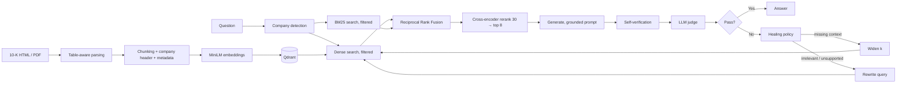

# FinRAG | Adaptive Self-Healing RAG System

A Retrieval-Augmented Generation system over SEC 10-K filings that checks its own retrieval and answers at query time, diagnoses *why* an answer failed, and repairs it — plus the evaluation harness, ablations and statistics needed to tell which of those mechanisms actually help.

**Author:** Navadeep Nandedapu

---

## Overview

Standard RAG pipelines retrieve context once, generate once, and return the result even when retrieval missed. This project treats retrieval and generation as failure-prone stages inside a LangGraph control loop: generate → self-verify → LLM judge → (if failing) choose a healing action → retrieve again, within a bounded retry budget.

The repository contains two versions of the pipeline, evaluated side by side on the same questions:

| | v1 (original) | v2 (current default) |
|---|---|---|
| Parsing | text extraction, one line per table cell | **table-aware**: one line per table row (`Net income \| 57,048 \| 58,471`) |
| Chunks | raw text | **contextual header** `[JPMorgan Chase \| Form 10-K \| fiscal year 2025]` + company / year metadata, deterministic ids |
| Retrieval | dense top-k | **company filter → dense ⊕ BM25 fused with RRF → cross-encoder rerank of 30 → top 8**; questions about several companies are **decomposed** into one search per company |
| Generation | "answer from the documents" | + grounding rules: right company only, quote figures exactly, never sum segments when a total is reported |
| Healing | every failure → retrieve 2–3 more chunks + rerank | **failure-aware**: missing context → widen; irrelevant docs / unsupported claims → LLM query rewrite; switch action if it did not help |

Set `RAG_STRATEGY=dense` to run the API / UI with v1.

## Pipeline (v2)



## Self-Healing Strategy

A retry is triggered when `score < 0.8`, the judge names a failure (`irrelevant_docs`, `missing_context`), or self-verification finds `unsupported_claims`; at most 3 retries.

| Failure reason | v1 action | v2 action (first try → if it recurs) |
|---|---|---|
| `missing_context` | k + 3, enable reranking | widen k by 4 → rewrite query |
| `irrelevant_docs` | k + 2, enable reranking | rewrite query into 10-K vocabulary → widen |
| `unsupported_claims` | k + 2, enable reranking | rewrite query → widen |
| low score, no reason | k + 2, enable reranking | widen → rewrite query |

Every decision is recorded in `healing_trace`, e.g. `"irrelevant_docs → rewrote search query: Amazon 2025 10-K Total net sales …"`.

### Models

| Purpose | Model |
|---|---|
| Embedding | `sentence-transformers/all-MiniLM-L6-v2` via FastEmbed |
| Sparse retrieval | BM25 (implemented in `langgraph_agent/bm25.py`) |
| Reranking | `jinaai/jina-reranker-v2-base-multilingual` |
| Generation, query rewriting | `openai/gpt-oss-120b` via Groq |
| Self-verification, judge | `openai/gpt-oss-20b` via Groq |

## Features

- **Ingestion** of PDFs (local or URL) and SEC filing HTML, with table-aware parsing and idempotent (deterministic-id) upserts
- **Company-aware retrieval**: contextual chunk headers, metadata filter, per-company query decomposition
- **Hybrid retrieval**: dense + BM25 with Reciprocal Rank Fusion, then cross-encoder rerank-and-truncate
- **Self-verification** (faithfulness to retrieved context) and **LLM-as-a-judge** (relevance, sufficiency)
- **Failure-aware self-healing** with bounded retries and an inspectable healing trace
- **Evaluation harness**: resumable experiment runner, retrieval ablation, McNemar tests, bootstrap CIs, judge confusion matrix
- **REST API** (`/health`, `/ingest`, `/query`), **Streamlit UI**, **Dockerized** backend with Qdrant as a separate service

## Evaluation

FinanceBench-style questions whose answers are stated in five real SEC 10-K filings (Amazon, JPMorgan Chase, Microsoft, NVIDIA, Walmart; ~4,250 chunks):

- **30 straightforward** questions (revenue, net income, operating income, EPS, total assets, cash, equity, employees, segments). Q01–Q10 are the original set; Q21–Q40 were added and every ground truth checked against the parsed filing text (source line in `notes`).
- **10 hard** questions: cross-company comparisons, computed net margins, fiscal-year-end dates, scored on structured `answer_facts` (what the answer must contain) and `evidence_facts` (what retrieval must find).

Answers are scored by `eval/scoring.py` (whole-token matching after Unicode / number normalisation; sign, unit and percent guards; unit-tested). Every stored answer is re-graded with the current scorer before any statistic is computed.

> **Ground-truth correction.** Q10 originally used 2,142,534 as JPMorgan's total assets. That is the *Commercial & Investment Bank segment's* total assets (10-K p. 71); the firm-wide figure is 4,424,900. All results below use the corrected value, which lowers the published v1 numbers: the v1 loop "recovered" Q10 to the segment figure and its judge passed it.

### Systems

| System | Version | What it does | LLM calls |
|---|---|---|---:|
| `plain_rag_k5` | v1 | dense top-5 → generate | 1 |
| `wide_rerank_k11` | v1 | dense top-11 → rerank → generate (the context the v1 loop reaches) | 1 |
| `self_healing` | v1 | LangGraph loop, dense, k = 5, +2/+3 per retry | 3 per attempt |
| `hybrid_single_pass` | v2 | v2 retrieval, k = 8 → grounded generate | 1 |
| `self_healing_v2` | v2 | LangGraph loop with v2 retrieval and failure-aware healing | 3 per attempt (+1 per rewrite) |

### Retrieval ablation (no LLM calls)

Each row adds one change; recall@k = the evidence facts are inside the top-k chunks; MRR over the first 30. main columns = 30 single-company questions (Q01–Q10, Q21–Q40), hard = Q11–Q20 (`eval/retrieval_ablation.json`).

| Config | Change | R@1 | R@3 | R@5 | R@11 | MRR | Hard R@5 | Hard R@11 | Hard MRR |
|---|---|---:|---:|---:|---:|---:|---:|---:|---:|
| `v1_dense` | Dense only, original parsing (v1) | 13% | 40% | 50% | 60% | 0.31 | 20% | 30% | 0.09 |
| `v2_dense` | + table-aware parsing + chunk headers | 17% | 40% | 43% | 60% | 0.31 | 0% | 30% | 0.06 |
| `v2_dense_filter` | + company filter | 17% | 40% | 43% | 60% | 0.31 | 0% | 30% | 0.06 |
| `v2_bm25_filter` | BM25 alone (with filter) | 43% | 70% | 80% | 87% | 0.59 | 20% | 30% | 0.15 |
| `v2_hybrid_filter` | Dense ⊕ BM25 via RRF | 27% | 60% | 77% | 87% | 0.47 | 20% | 30% | 0.15 |
| `v2_hybrid_filter_rerank` | + cross-encoder rerank of 30 | 73% | 97% | 97% | 97% | 0.84 | 30% | 30% | 0.18 |
| **`v2_full`** | + per-company decomposition (= v2) | 73% | 97% | 97% | 97% | 0.84 | 50% | 80% | 0.33 |
| `v2_full_nofilter` | v2 without the filter | 73% | 97% | 97% | 97% | 0.84 | 30% | 30% | 0.18 |


### End-to-end results

Original questions Q01–Q10 (v1 systems: 3 runs; v2: 1 run so far — the Groq free tier allows 200K tokens/day per model, so the remaining cells are queued and resume with `bash eval/run_all.sh`):

| | Plain RAG | Wide single pass | v1 loop | **v2 single pass** | **v2 loop** |
|---|---:|---:|---:|---:|---:|
| Correct | 15/30 (50%) | 18/30 (60%) | 19/27 (70%) | **10/10** | **7/7** (Q01–Q07) |
| Mean LLM calls | 1 | 1 | 5.7 | 1 | 3.0 (no retries needed) |
| Mean latency* | 1.6 s | 3.7 s | 46.8 s | 8.5 s | 20.2 s |

\*Groq free tier; includes rate-limit back-off. v2 single-pass latency is dominated by reranking 30 candidates on CPU.

| Question | Plain | Wide | v1 loop | v2 single pass | What changed |
|---|:-:|:-:|:-:|:-:|---|
| Q01–Q04 revenue / net sales | ✓ | ✓ | ✓ | ✓ | |
| Q05 JPMorgan net income | ✗ | ✗ | ✗ | ✓ | v1 summed three segment net incomes ($52,528M) and both checks passed it; v2 quotes the reported $57,048M |
| Q06 Microsoft employees | ✗ | ✗ | ✗ | ✓ | not in v1's top-11 at all; BM25 + rerank finds the Human Capital chunk |
| Q07 NVIDIA segments | ✗ | ✓ | ✓ | ✓ | |
| Q08 Walmart associates | ✗ | ✓ | ✓ | ✓ | |
| Q09 Amazon segments | ✓ | ✗ | ✓ | ✓ | v1 wide pass answered with Microsoft's segments; company headers / filter prevent it |
| Q10 JPMorgan total assets | ✗ | ✗ | ✗ | ✓ | v1 picked the segment table; v2 the firm-wide figure |

On the 20 added questions only a few cells ran before the daily limit (v2 single pass 3/3, plain 2/4, wide 2/3); they are excluded from the headline until complete.

### Statistics

`python eval/analysis.py` (exact McNemar on per-question majority outcomes, Holm-adjusted across the 6 comparisons; 95% bootstrap CIs over questions):

| Comparison (Q01–Q10) | Discordant (A only / B only) | p | p (Holm) |
|---|---:|---:|---:|
| wide single pass vs v2 single pass | 0 / 5 | 0.062 | 0.375 |
| plain RAG vs v1 loop | 0 / 2 | 0.50 | 1.0 |
| wide single pass vs v1 loop | 0 / 1 | 1.0 | 1.0 |

- **v2 never lost a question that v1 got right**, but with 10 questions even a 5–0 split is not significant at 0.05. The 20 added questions exist to fix exactly this.
- **Judge calibration (v1 loop, 27 final answers):** P(correct | judge passed) = 0.79; the judge flagged only 3 of 8 wrong answers (37.5%). A self-healing loop can only repair what its judge catches, so this recall caps its benefit.

### Findings

- **Retrieval was the bottleneck, not the loop.** v1's loop beat plain RAG mainly by retrieving more; a wide single pass got most of the gain at 1/6 of the LLM calls. Fixing retrieval (v2) moved recall@5 from 50% to 97% on 30 questions and the single pass to 10/10 — and the v2 loop then needed zero retries on the questions it ran. The loop becomes a safety net rather than the main mechanism.
- **A change can hurt one component and help the system.** Table-aware parsing + chunk headers made *dense-only* recall@5 worse (50% → 43%): pipe-separated rows embed less naturally. But the same chunks made BM25 strong (80%) and hybrid + rerank best (97%). Without an ablation you would have reverted a change that is essential to the final system.
- **Exact tokens need sparse retrieval.** BM25 alone beats dense alone (R@5 80% vs 43% on v2 chunks): financial questions hinge on exact line items and numbers that embeddings blur. Naive RRF fusion is slightly *worse* than BM25 alone here (77% vs 80%): the weaker dense ranking dilutes it. Reranking the fused pool fixes that (97%, MRR 0.47 → 0.84) — fusion buys recall, the cross-encoder buys precision.
- **Headers fixed entity confusion; the filter is a guarantee, decomposition is the win.** Entity precision@5 was already 95% for v1 and 100% with headers, so the filter adds nothing on single-company questions — but it enables per-company decomposition, which lifted multi-company recall@11 from 30% to 80%.
- **The judge is the ceiling of a self-healing loop.** v1's judge passed 5 wrong answers (precision 0.79) and caught only 3 of 8 wrong ones. Q05 (segment sum) and Q10 (segment assets) were passed with high scores. Reasoning errors were fixed by grounded prompt rules, not by more retrieval — v2 quotes $57,048M.
- **Audit the evaluation, not just the model.** Two eval bugs changed conclusions: a scorer that split numbers on commas, and a Q10 label that was a segment figure. After the fix v1 numbers dropped 10 points — the honest baseline is what makes the v2 improvement credible.
- **Claims must match sample size.** On 10 questions, v2 single pass vs wide pass is 5–0 on discordant questions: McNemar p = 0.062, Holm-adjusted 0.375. Directionally strong, not significant — hence 40 verified questions.


### Limitations

- Small question set (30 + 10) written by the author after reading the corpus; v2's prompt rules were motivated by observed v1 failures. A held-out set is needed to claim generalisation.
- v1 vs v2 end-to-end comparisons change several components at once; only the retrieval ablation isolates single changes.
- LLM outputs vary between runs; v2 has fewer runs than v1 so far (daily token limit).
- Company detection is a regex alias registry for the five companies in the corpus.
- The verifier and judge share a model family with the generator and can share its blind spots.
- BM25 is an in-memory index rebuilt per process; at scale it belongs in the vector store (sparse vectors) or a search engine.

## API Usage

### Health check

```http
GET /health
```

### Ingest a document

```http
POST /ingest
{
  "url": "https://arxiv.org/pdf/2312.10997"
}
```

Returns the number of chunks ingested and the total stored in the collection.

### Query

```http
POST /query
{
  "question": "What was Microsoft's total revenue for fiscal year 2026?"
}
```

Example response:

```json
{
  "answer": "...",
  "score": 0.95,
  "retrieval_strategy": "hybrid",
  "retrieval_mode": "original",
  "search_query": "Amazon 2025 10-K segment information reportable segments",
  "retrieval_budget": 8,
  "retry_count": 1,
  "healing_trace": [
    "irrelevant_docs → rewrote search query: Amazon 2025 10-K segment information reportable segments"
  ]
}
```

These fields make the recovery process observable instead of hiding it behind the final answer.

## Getting Started

Requires Python 3.11+. Docker commands below use PowerShell syntax but are OS-agnostic in intent.

### 1. Clone and configure

```bash
git clone https://github.com/NNavadeep05/adaptive-self-healing-rag.git
cd adaptive-self-healing-rag
```

Create a `.env` file:

```env
GROQ_API_KEY=your_groq_api_key_here
QDRANT_URL=http://qdrant:6333
```

`.env` is git-ignored and should never be committed. For a purely local setup without Dockerized Qdrant, point `QDRANT_URL` at your locally running Qdrant instance instead.

### 2. Option A — Local Streamlit + local Qdrant

```bash
python -m venv .venv
.\.venv\Scripts\Activate.ps1
pip install -r requirements.txt
streamlit run app.py
```

Qdrant must be reachable at the configured `QDRANT_URL`.

### 3. Option B — Dockerized backend + Qdrant

```powershell
docker network create rag-network

docker run -d `
  --name qdrant `
  --network rag-network `
  -p 6333:6333 -p 6334:6334 `
  qdrant/qdrant

docker build -t adaptive-self-healing-rag .

docker run -d `
  --name adaptive-self-healing-rag `
  --env-file .env `
  --network rag-network `
  -p 8000:8000 `
  adaptive-self-healing-rag
```

Inside the Docker network, the backend reaches Qdrant through its service name (`http://qdrant:6333`). `localhost` inside the backend container refers to the backend itself.

The Streamlit UI runs separately:

```bash
streamlit run app.py
```

## Project Structure

```text
adaptive-self-healing-rag/
├── api.py                          # FastAPI backend and REST endpoints
├── app.py                          # Streamlit UI
├── eval_queries.json               # 40 evaluation questions with verified ground truths
├── requirements.txt / requirements-dev.txt
├── Dockerfile, .dockerignore, .gitignore, pytest.ini
├── langgraph_agent/
│   ├── graph.py                    # LangGraph workflow + initial state (strategy, collection)
│   ├── nodes.py                    # retrieve / generate / verify / score / retry nodes (v1 + v2)
│   ├── healing_policy.py           # v2 failure → action mapping
│   ├── hybrid_retrieval.py         # v2: filter, dense ⊕ BM25, RRF, rerank, decomposition
│   ├── bm25.py                     # BM25 index and Reciprocal Rank Fusion
│   ├── metadata.py                 # company registry, chunk headers, deterministic ids
│   ├── table_text.py               # table-aware HTML → text
│   ├── query_rewrite.py            # LLM query rewriting (healing action)
│   ├── retrieve_docs.py            # embeddings, Qdrant I/O, reranker, LLM calls
│   └── document_loader.py          # PDF / HTML loading and chunking
├── eval/
│   ├── ingest_corpus.py            # builds the v1 / v2 evaluation collections
│   ├── scoring.py                  # answer matching (unit-tested)
│   ├── questions.py                # question loading, answer / evidence targets
│   ├── retrieval_ablation.py       # recall@k, MRR, entity precision per config (no LLM)
│   ├── compare_systems.py          # resumable end-to-end comparison of all 5 systems
│   ├── analysis.py, stats.py       # McNemar, Holm, bootstrap CI, judge confusion matrix
│   ├── run_all.sh                  # every LLM evaluation in priority order (resumable)
│   ├── retrieval_ablation.json     # ablation results
│   ├── results/                    # per-cell results, summaries, analysis.json
│   └── full_pipeline_results.json  # raw v1 runs (imported into results/)
└── tests/                          # pytest suite, no LLM or Qdrant calls
```

## Repository Data

The raw SEC filing corpus and local Qdrant storage are excluded from Git. To run the evaluation, place the filings under `data/sec_filings/`:

```text
amazon_2025.html
jpmorgan_2025.html
microsoft_2026.html
nvidia_2026.html
walmart_2026.html
```

File names matter: `<company>_<fiscal year>` is how chunks get their company metadata.

## Run Evaluation

```bash
python eval/ingest_corpus.py --version v1   # "sec_filings_eval": original parsing
python eval/ingest_corpus.py --version v2   # "sec_filings_eval_v2": table-aware + headers
python eval/retrieval_ablation.py           # retrieval only, no LLM calls
bash eval/run_all.sh                        # all LLM evaluations; re-run to resume after rate limits
python eval/analysis.py                     # statistics over the stored results
```

`compare_systems.py` stores every (run, question, system) cell in `eval/results/<bucket>.json`, checkpointing after each cell; re-running fills only missing or errored cells, and a system that hits the provider's daily token limit is paused instead of burning retries. Evaluation collections are separate from the application's `documents` collection.

## Tests

```bash
pip install -r requirements-dev.txt
pytest
```

The suite covers answer matching, BM25 ranking, rank fusion, table parsing, company detection, deterministic ids, the healing policy and retry logic (v1 and v2), graph wiring, re-grading, and the statistics helpers. It makes no LLM or Qdrant calls.

## Data & References

- **Data source:** all five filings (Amazon, JPMorgan Chase, Microsoft, NVIDIA, Walmart) are official 10-K annual reports from [SEC EDGAR](https://www.sec.gov/edgar), the U.S. Securities and Exchange Commission's public filing database.
- **Evaluation design:** the direct-lookup question style follows [FinanceBench](https://arxiv.org/abs/2311.11944) (Islam et al., 2023), a benchmark for RAG over real SEC filings.

## Acknowledgements

- The LangGraph retrieve → generate → judge → retry structure began as a from-scratch reimplementation of [gurezende/SelfHealingRAG](https://github.com/gurezende/SelfHealingRAG) (MIT License) by Gustavo R. Santos, used as a learning reference.
- The self-verification stage follows the Self-Verification Module described in *SH-RAG: Self-Healing Retrieval-Augmented Generation — A Self-Correcting RAG Framework for Large Language Models* (Kumawat, Jawdekar, Patsariya, Gupta; PiCET 2025, IEEE), verified by entailment against the retrieved context rather than by external fact-checking. The paper's reinforcement-learning feedback loop is not implemented.
- Contextual chunk headers follow the idea of Anthropic's [Contextual Retrieval](https://www.anthropic.com/news/contextual-retrieval) (here a deterministic metadata header rather than an LLM-generated one); fusion uses Reciprocal Rank Fusion (Cormack, Clarke & Büttcher, SIGIR 2009).
- Additions in this repository: self-verification, Groq-hosted open-weight models, FastAPI service, Dockerized Qdrant, SEC-filing ingestion, the v2 retrieval and healing pipeline, and the FinanceBench-style evaluation set, harness and statistics.

## License

This project is intended as an engineering and portfolio demonstration of adaptive retrieval and self-healing RAG workflows.
